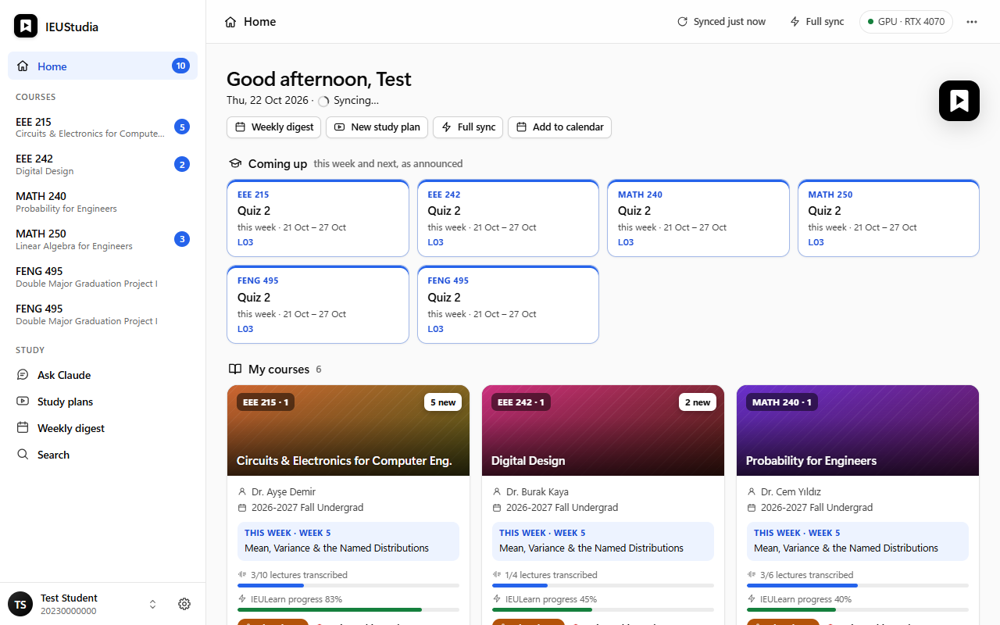
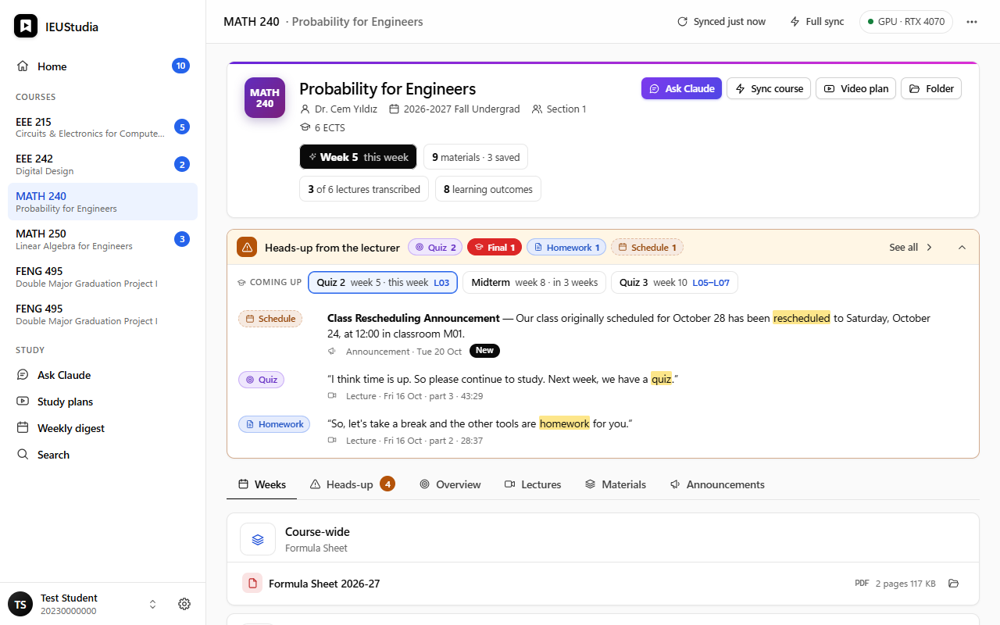
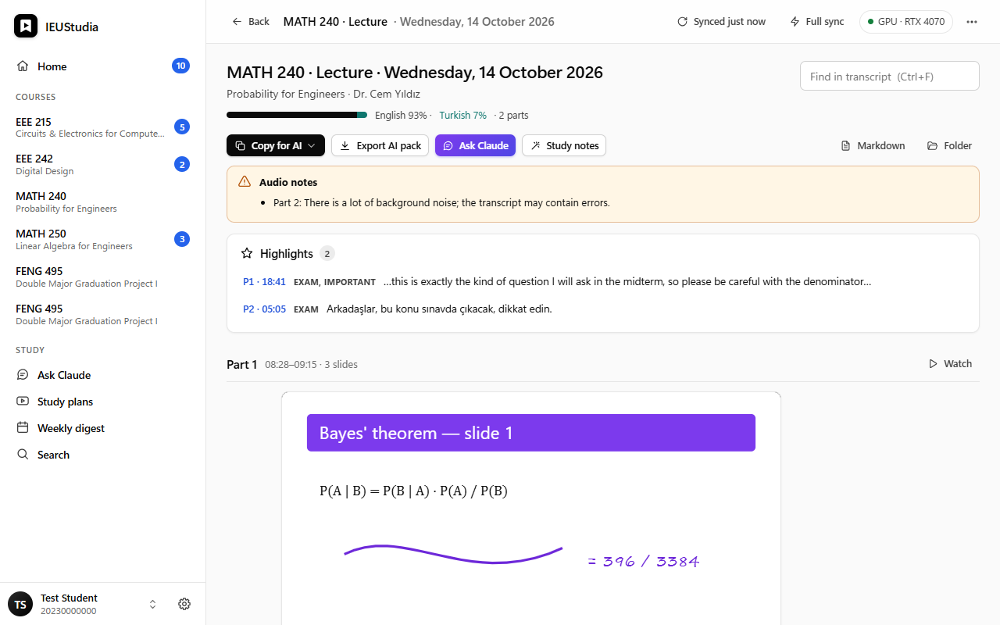
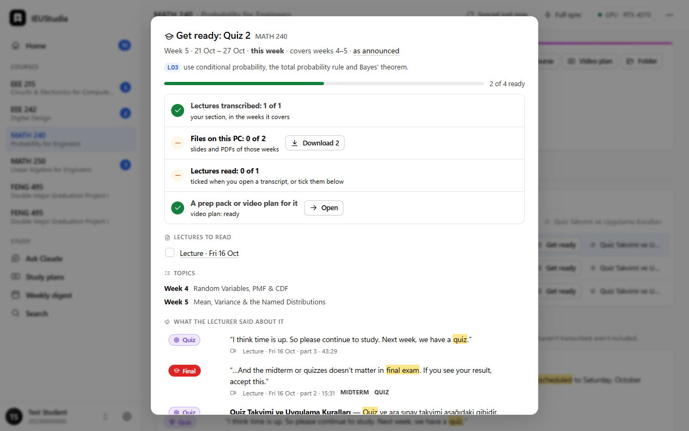
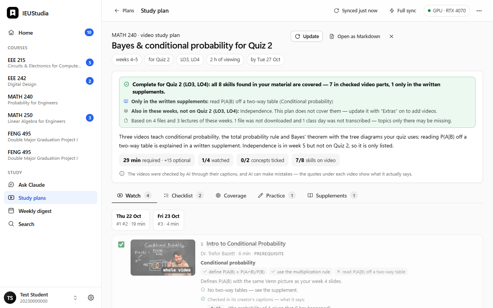
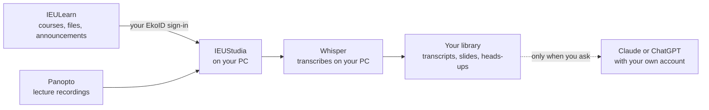
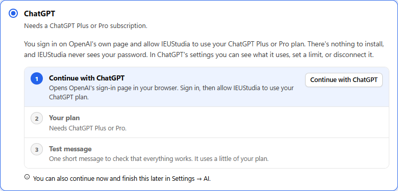

<p align="center">
  <picture>
    <source media="(prefers-color-scheme: dark)" srcset="docs/logo-dark.svg">
    
  </picture>
</p>

<h1 align="center">IEUStudia</h1>

<p align="center">
  A Windows app for İzmir University of Economics students.<br>
  It puts your IEULearn courses in one window, turns your Panopto lectures into searchable text on your own PC,<br>
  and keeps track of what your lecturers say about quizzes and exams.
</p>

<p align="center">
  <a href="https://github.com/mirzaisi/IEUStudia/releases/latest"></a>
  <a href="https://github.com/mirzaisi/IEUStudia/actions/workflows/ci.yml"></a>
  <a href="LICENSE"></a>
</p>

<p align="center">
  
</p>

> [!NOTE]
> IEUStudia is an unofficial project made by students. İzmir University of Economics, IEULearn and Panopto have
> nothing to do with it and don't support it.

## Why it exists

Everything you need for a course is on IEULearn, but it's spread out. The slides are on one page, the recording is
somewhere in Panopto, and the announcement about Thursday's quiz is buried under three others. When a lecturer says
"this will be on the midterm", that sentence is somewhere in a 75-minute video.

IEUStudia collects what you can already open with your own account, sorts it by course and week, and transcribes the
lectures on your computer, so you can search them and jump straight to the moment something was said.

## What you can do with it

**See each course week by week.** Every course gets a page with its weekly topics (from the syllabus, in English and
Turkish), the slides and PDFs, the lecture recordings of your own section and the announcements. The learning
outcomes and the assessment plan are there too, so you can see which quiz covers what.

**Read and search your lectures.** Pick a lecture and it's transcribed on your PC with Whisper. Lectures are mostly in
English; Turkish parts are kept the way they were said and marked `[TR]`. Each paragraph links back to its moment in
the recording, and the slides from the screen recording show up next to the text. One search box covers all your
lectures and course files.

**Don't miss a quiz.** Whenever a lecture or an announcement mentions a quiz, the midterm, the final, homework or a
change in the schedule, it shows up on the course page. Before a quiz, *Get ready* lists the lectures to catch up on,
the files to download and what the lecturer said about it. Quizzes and exams can go into your calendar, and a weekly
digest sums up what happened.

**Get a notification when something new appears.** If you want, a small helper stays in the notification area,
checks IEULearn every half hour and shows a Windows notification for new recordings, announcements and files. It can
start with Windows. It never transcribes or downloads anything on its own.

**Use AI with your own subscription.** With Claude or ChatGPT you can chat about your lectures (answers point to the
exact moment they come from), write study notes or flashcards, put together an exam prep pack, or make a video study
plan: YouTube videos for your weeks, each one checked through its captions against what your course actually
covers. All of this is optional, see [AI features](#ai-features).

<table>
  <tr>
    <td width="50%"><br><sub>A course, week by week, with what's coming up.</sub></td>
    <td width="50%"><br><sub>A transcribed lecture. A timestamp opens the recording at that moment.</sub></td>
  </tr>
  <tr>
    <td width="50%"><br><sub>Getting ready for a quiz.</sub></td>
    <td width="50%"><br><sub>A video study plan, with the caption quotes it relied on.</sub></td>
  </tr>
</table>

## How it works



Everything runs on your computer. There's no IEUStudia server and no account with us. Your EkoID password goes only
to learn.ieu.edu.tr, the same as when you sign in on the website.

## Installing

1. Download `IEUStudia-Setup-<version>.exe` from the [latest release](https://github.com/mirzaisi/IEUStudia/releases/latest).
2. Run it. It installs for your Windows account only, so you don't need admin rights. The installer isn't
   code-signed yet, so Windows SmartScreen will probably warn you. Click *More info*, then *Run anyway*.
3. Open IEUStudia. The first start takes you through a few short steps:
   - a notice about what the app does with your data,
   - a check of your PC (if it can't run IEUStudia, it tells you why and stops there),
   - the speech model for transcription,
   - AI, if you want it,
   - the tray helper and notifications,
   - the downloads, with their sizes shown before anything starts,
   - and signing in to IEULearn.

Each release also has a portable zip if you'd rather not install anything.

### What your PC needs

|  | Minimum | Better |
|---|---|---|
| Windows | 10 (version 1809) or 11, 64-bit | 11 |
| Processor | x64 with AVX | 8 or more threads, with AVX2 |
| Memory | 4 GB | 8 GB or more |
| Free disk space | about 3 GB | about 10 GB with the offline AI model |
| Graphics card | not needed | NVIDIA with 4 GB or more |

The Microsoft Edge WebView2 Runtime is needed as well. Windows 11 and up-to-date Windows 10 already have it, and the
installer checks.

Transcription speed depends mostly on the graphics card. With a recent NVIDIA card, an hour of lecture takes a few
minutes. Without one, the setup picks the small speech model, which runs on the processor: an hour of lecture then
takes roughly 20 minutes to an hour, depending on the processor. It runs in the background, so you can keep using
the app (or your PC) meanwhile.

## AI features

AI is optional. Transcripts, heads-ups, search and everything else work without it. There are four choices:

| Choice | What you need | What you get |
|---|---|---|
| Claude | A Claude Pro or Max subscription | Everything: chat, notes, flashcards, prep packs, video study plans. |
| ChatGPT | A ChatGPT Plus or Pro subscription | The same features. |
| Offline model | Nothing to pay for, but at least 8 GB of memory | Short notes and simple questions, on your PC (Qwen3 1.7B or 4B). No study plans. |
| No AI | Nothing | The AI buttons are hidden. |

You can change your choice any time in *Settings → AI*.

### How Claude and ChatGPT are connected

You don't need the Claude or ChatGPT desktop apps, and IEUStudia never sees your Claude or ChatGPT password. When you
pick one of them, the setup shows a short checklist and goes through it with you. You don't have to open a terminal.

**ChatGPT** uses *Continue with ChatGPT*, OpenAI's sign-in for open-source apps. You sign in on OpenAI's page in your
browser and allow IEUStudia to use your ChatGPT plan; there's nothing to install. You can see how much IEUStudia
uses, set a limit or disconnect it any time in [ChatGPT's settings](https://chatgpt.com/settings/usage). On Plus,
apps share the plan's five-hour usage limit with each other. If you already use OpenAI's
[Codex CLI](https://github.com/openai/codex), IEUStudia can use that instead.

**Claude** works through [Claude Code](https://code.claude.com/docs), Anthropic's official command-line tool, because
Anthropic only allows signing in with a Claude subscription through its own apps. The checklist installs Claude Code
from claude.ai, opens Anthropic's sign-in page, checks that your plan includes Claude Code, and sends a short test
message.

<p align="center"></p>

If something goes wrong, the step that failed says why, and *Settings → AI* has the same checklist for later.

AI only runs when you ask for something, and it counts against your plan's normal usage limits. AI can also be wrong.
Answers point to the lecture moments they're based on so you can check them, and video study plans show the caption
quotes behind every video they recommend.

## Privacy

- Your EkoID password is sent only to learn.ieu.edu.tr. On your PC it's stored encrypted with Windows DPAPI, so only
  your Windows account can read it.
- There's no IEUStudia server, no account, no analytics and no tracking.
- IEUStudia connects to IEULearn and Panopto (your courses and recordings), the public İEÜ syllabus pages, Hugging Face
  (to download the speech model and the offline AI model, once), PyPI (NVIDIA's GPU libraries, once, only if you have
  an NVIDIA card), YouTube (search and captions, only for video study plans), and Anthropic or OpenAI (only when you
  use an AI feature; the lecture text you chose is sent to them under your account). Setting up Claude downloads
  Claude Code from claude.ai; signing in with ChatGPT happens on auth.openai.com.
- The ChatGPT sign-in is kept on your PC encrypted with DPAPI, like your EkoID password. It only allows requests on
  your plan, not access to your ChatGPT conversations.
- App data (settings, the encrypted login, your library, models, logs) is kept in `%LOCALAPPDATA%\IEUStudia`.
  Transcripts, notes and downloaded files go to `Documents\IEUStudia`.

## Uninstalling

Use *Windows Settings → Apps*. The uninstaller asks whether to delete IEUStudia's data too. Your transcripts and notes
in Documents are never deleted.

## Questions

**Is this allowed?**
IEUStudia uses your own IEULearn account and only gets what you could already open in your browser. Recordings and
slides belong to your lecturers and the university, so keep what you download for your own studying and don't share
it. Follow your university's rules.

**Do I need a powerful PC?**
No. The setup checks your PC and picks a speech model that fits. An NVIDIA graphics card just makes transcription a
lot faster.

**Do I need the Claude or ChatGPT app?**
No, you need the subscription, not the app. ChatGPT connects with a sign-in in your browser. For Claude, IEUStudia
installs Claude Code for you during setup (see [above](#how-claude-and-chatgpt-are-connected)).

**Does the free ChatGPT or Claude plan work?**
Not for the AI features. OpenAI lets apps use only ChatGPT Plus and Pro plans, and Claude Code needs Claude Pro or Max.
Everything else in IEUStudia works without any subscription, and the offline model, which runs on your PC, is free.

**Does it work on a Mac or on Linux?**
Not right now. It depends on Windows parts such as WebView2, DPAPI and the notification area.

**Something stopped working after IEULearn changed.**
That can happen. Please [open an issue](https://github.com/mirzaisi/IEUStudia/issues) and describe what you were
doing. Leave out your name, student number and course content, also in screenshots.

## Building it yourself

You need Windows and [uv](https://docs.astral.sh/uv/).

```powershell
uv sync --group dev            # a Python 3.12 environment in .venv
uv run studia --debug          # run the app with developer tools
uv run pytest -q               # run the tests
.\scripts\build_release.ps1    # the installer and the portable zip, in build\installer
```

The interface is plain HTML, CSS and JavaScript in `src/studia/web`. Open `index.html` in a browser to work on it with
made-up data; `#dark`, `#signin` and `#setup` show other states. Setting `STUDIA_HOME` to a folder runs the app with
separate data (the tests do this), and `STUDIA_FAKE_ENGINE=1` replaces Whisper with a stub. `install.cmd` installs a
development build for your Windows account.

Releases are built by GitHub Actions: pushing a version tag such as `v2.1.0` builds the installer and the zip and
attaches them to a draft release.

<details>
<summary>Where things are in the code</summary>

| Part | Files |
|---|---|
| IEULearn and Panopto | `ieulearn.py`, `panopto.py`, `coursesite.py`, `syllabus.py`, `sync.py` |
| Transcription | `engine/`, `jobs.py`, `quality.py`, `slides.py`, `outputs/` |
| Study features | `alerts.py`, `catchup.py`, `plans.py`, `videos.py`, `digest.py`, `calendar_export.py` |
| AI | `ai.py`, `ai_setup.py`, `local_llm.py`, `chat.py`, `knowledge.py` |
| Desktop | `app.py`, `api.py`, `splash.py`, `agent.py`, `tray.py`, `hardware.py`, `components.py` |
| Interface | `web/` |

</details>

## Contributing

Issues and pull requests are welcome, and [CONTRIBUTING.md](CONTRIBUTING.md) explains how to get started. Please
never put real student data, passwords or lecture content in issues, tests or screenshots. Security problems should
be reported privately, as described in [SECURITY.md](SECURITY.md).

## Disclaimer

IEUStudia is an independent project. It isn't affiliated with, endorsed by or supported by İzmir University of
Economics, IEULearn or Panopto; their names are only used to say what the app works with. It's provided as is,
without any warranty (see the [license](LICENSE)), and its authors aren't responsible for how it's used or for any
data you lose. AI features can make mistakes, so check AI answers against your lectures and materials.

## License

IEUStudia is released under the [MIT License](LICENSE). The parts it builds on keep their own licenses:
faster-whisper and the Whisper models (MIT), CTranslate2 (MIT), the Qwen3 models (Apache-2.0), pywebview
(BSD-3-Clause), PyAV (BSD-3-Clause), yt-dlp (Unlicense) and pypdfium2 (Apache-2.0 or BSD-3-Clause). NVIDIA's CUDA
libraries are downloaded from NVIDIA's own packages on PyPI and are covered by NVIDIA's license. Claude Code and the
Codex CLI are installed from their official sources and come under Anthropic's and OpenAI's own terms. IEUStudia
isn't made or endorsed by Anthropic or OpenAI.
